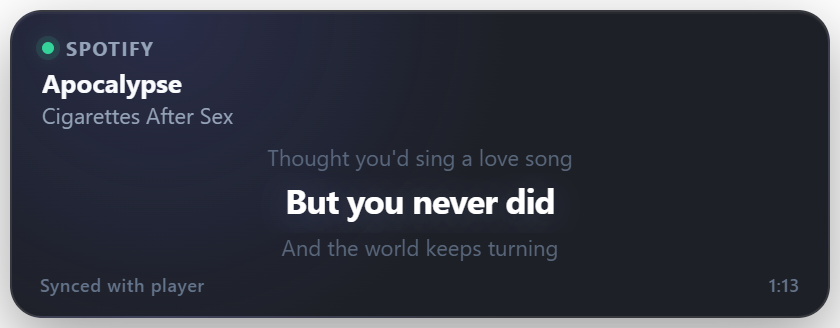
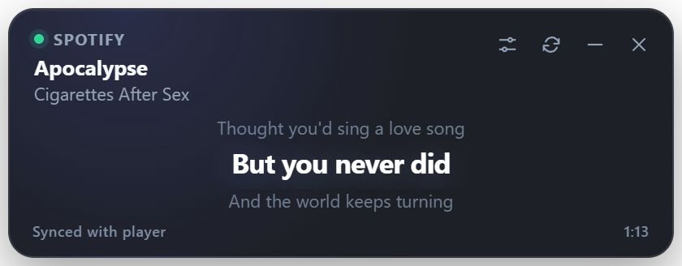
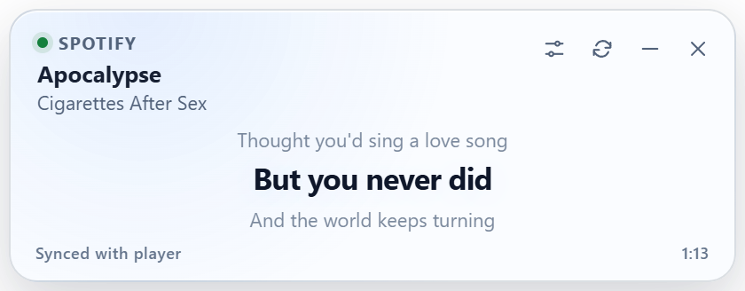
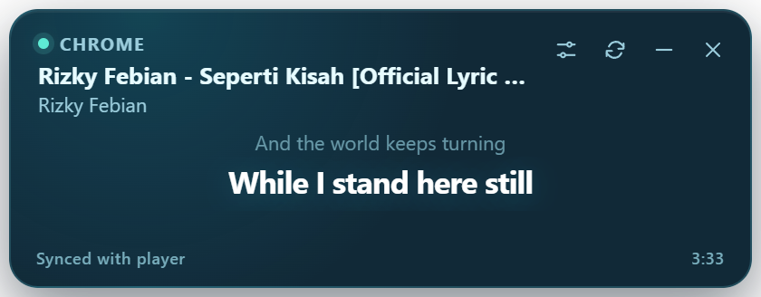
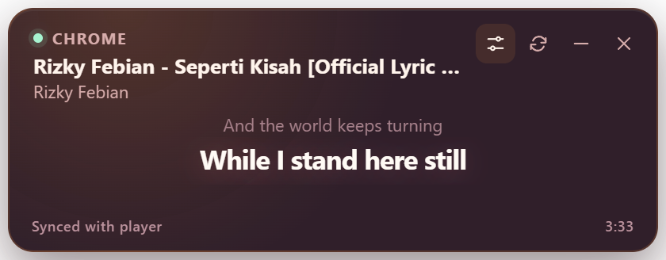

# CornerLyrics

A small, always-on-top lyrics widget for Windows. CornerLyrics reads the song currently playing through the Windows Media Session, finds matching lyrics on LRCLIB, and keeps the current line in sync with playback—without switching away from your work.



## Features

- **Always-on-top desktop widget** with a clean, translucent interface.
- **Automatic now-playing detection** through the Windows Global System Media Transport Controls API.
- **Synchronized LRC lyrics** with previous, current, and next lines.
- **Smart LRCLIB matching** using track title, artist, album, and duration, with search fallback.
- **Plain-lyrics and instrumental fallbacks** when synchronized lyrics are unavailable.
- **Four built-in themes** — Dark, Light, Ocean, and Sunset — with instant switching and saved preferences.
- **Draggable and resizable** window with its position saved between sessions.
- **Minimal controls** to choose a theme, refresh lyrics, minimize, or close the widget.
- **Portable and installer builds** for 64-bit Windows.
- **Privacy-conscious architecture:** no account, no media library scan, and no audio or local lyrics files uploaded.

## Themes

Hover over the overlay and click the **Choose theme** button to open the compact picker. Select **Dark**, **Light**, **Ocean**, or **Sunset**; the change applies immediately and the picker closes.

Dark is the default. Your selection is saved in `settings.json` and restored after restarts. The portable build stores settings in the `CornerLyrics Data` folder beside the executable; the installed build uses the standard per-user application data location.

### Theme gallery

| Dark | Light |
| --- | --- |
|  |  |

| Ocean | Sunset |
| --- | --- |
|  |  |

## Download

Download **CornerLyrics 1.0.3** from the [GitHub Releases page](https://github.com/luthfi55/CornerLyrics/releases/tag/v1.0.3).

| Build | Download | Notes |
| --- | --- | --- |
| Portable | [CornerLyrics.1.0.3.Portable.exe](https://github.com/luthfi55/CornerLyrics/releases/download/v1.0.3/CornerLyrics.1.0.3.Portable.exe) | About 105 MB. No installation required; settings are stored beside the executable. |
| Installer | [CornerLyrics.Setup.1.0.3.exe](https://github.com/luthfi55/CornerLyrics/releases/download/v1.0.3/CornerLyrics.Setup.1.0.3.exe) | Installs CornerLyrics and creates desktop and Start menu shortcuts. |
| Checksums | [SHA256SUMS.txt](https://github.com/luthfi55/CornerLyrics/releases/download/v1.0.3/SHA256SUMS.txt) | SHA-256 hashes for both executables. |

The executables are distributed through GitHub Releases rather than committed to Git. These builds are not code-signed, so Windows SmartScreen may show a warning on first launch. Verify the checksums if you want to confirm that a download matches the published file.

To verify the portable download in PowerShell:

```powershell
Get-FileHash ".\CornerLyrics.1.0.3.Portable.exe" -Algorithm SHA256
```

Compare the result with the corresponding line in `SHA256SUMS.txt`.

## Usage

1. Start a song in an app or browser tab that publishes Windows Media Session metadata, such as Spotify, VLC, foobar2000, Chrome, or Microsoft Edge.
2. Launch **CornerLyrics**. The widget opens in the lower-right corner and begins reading the active media session.
3. Wait briefly while LRCLIB is queried. Synced lyrics appear automatically when a match is available.
4. Drag the card to reposition it. Resize it from its edges, and hover over the upper-right corner for the theme, refresh, minimize, and close buttons.
5. Use **Refresh lyrics** if a track has no match or if you want to retry after a network error.

The portable build keeps its local data in a `CornerLyrics Data` folder next to the executable, including window state and the selected theme. The installed build uses the standard per-user application data location.

## How synchronization works

CornerLyrics uses Microsoft's `GlobalSystemMediaTransportControlsSessionManager` to read the active Windows media session. A small PowerShell helper reports the track title, artist, album, playback state, duration, and current playback position.

When the track changes, CornerLyrics queries the [LRCLIB API](https://lrclib.net/docs). It first tries a duration-aware exact lookup when possible, then falls back to search and ranks candidates by metadata similarity and the availability of synchronized lyrics.

Synchronized lyrics arrive in LRC format, with a timestamp for each line. CornerLyrics parses those timestamps and compares them with the media timeline to select the active line. Playback position is extrapolated while music is playing and frozen while paused. If LRCLIB has only unsynchronized lyrics, the widget displays plain text instead; instrumental tracks receive a dedicated state.

Lyrics are fetched only when the track identity changes or when you request a refresh. Recent results are cached in memory for the current session.

## Build from source

### Requirements

- Windows 10 version 1809 (build 17763) or later, or Windows 11.
- 64-bit Windows for the provided Electron Builder targets.
- Node.js and npm with support for the Electron version in `package.json`.
- An internet connection to install dependencies, download Electron, and query LRCLIB at runtime.
- Enough free disk space for `node_modules`, Electron, and packaged build output.

### Commands

```powershell
git clone https://github.com/luthfi55/CornerLyrics.git
cd CornerLyrics
npm install
npm start
```

Create the installer and portable executable:

```powershell
npm run build
npm run build:portable
```

The generated files are written to `dist/`:

- `CornerLyrics Setup 1.0.3.exe`
- `CornerLyrics 1.0.3 Portable.exe`

Run the dependency-free test suite and syntax checks with:

```powershell
npm test
node --check src/main.cjs
node --check src/preload.cjs
node --check src/renderer/renderer.js
```

## Requirements and limitations

- **Windows only.** Automatic media detection depends on Windows Media Session APIs and is not available on macOS or Linux.
- **The player must publish media metadata.** Apps that do not expose a Windows Media Session, or provide blank/non-standard titles and artists, may not produce useful matches.
- **An internet connection is required for lyrics.** Previously fetched lyrics are cached only in memory, so restarting the app clears them.
- **Lyrics availability and timing vary.** LRCLIB is community-maintained; some tracks are missing, incorrectly tagged, or only available as plain text.
- **Line-level synchronization only.** Word-by-word highlighting is not implemented.
- **No manual search or playback controls.** CornerLyrics displays the current Windows media session rather than managing a music library.
- **Not an overlay exclusion mode.** The window stays above ordinary windows, but other always-on-top windows may still appear above it.
- **Unsigned release builds.** SmartScreen or organization policies may require users to approve the executable before it runs.

## Credits

CornerLyrics is built with and inspired by:

- [Electron](https://www.electronjs.org/) for the cross-platform desktop application framework.
- Microsoft Windows Media APIs, especially [`GlobalSystemMediaTransportControlsSessionManager`](https://learn.microsoft.com/en-us/uwp/api/windows.media.control.globalsystemmediatransportcontrolssessionmanager), for now-playing metadata and playback timing.
- [LRCLIB](https://lrclib.net/) and its contributors for the open lyrics database and public API.

All song titles, artist names, and lyrics shown by the app belong to their respective owners.

## License

CornerLyrics is released under the [MIT License](LICENSE).
